# PERT y Camino Crítico — SportMatch (Versión Devs, v3)

> **Versión filtrada para el equipo de desarrollo, recalculada con [[Estimaciones WBS - Estimacion WBS v3.csv]].** Considera únicamente los 43 paquetes que consumen horas de los 2 devs bajo el supuesto de productividad acelerada con IA.
>
> Para la versión dev con estimaciones originales ver [[PERT y Camino Crítico (Devs)]].
> Para la versión completa con v3 ver [[PERT y Camino Crítico (v2 IA)]].

---

## 1. Supuestos del modelo

- **Unidad de tiempo:** horas de esfuerzo del equipo dev.
- **Capacidad del equipo:** 2 devs × 6 h/sem = **12 h/sem**.
- **Estimaciones:** 3 puntos PERT — `(DO + 4·DM + DP) / 6`. Datos en [[Estimaciones WBS - Estimacion WBS v3.csv]].
- **Dependencias duras:** solo las dev↔dev. Las deps hacia paquetes excluidos (1.x, 2.x, 3.1.1, 8.x, 10.1.x) se eliminan asumiendo que el input externo está listo cuando el dev empieza.
- **Dependencias blandas (criterio PM):** se conservan `3.1.3 → 3.2.1` y `3.1.2 → 4.1.1` para reflejar que la capacitación tiene que terminar antes de empezar a codear.
- **PERT puro:** se permite paralelismo entre tareas independientes (ver §5 para la lectura realista de calendario con solo 2 devs).

---

## 2. Resultado principal

| Métrica | Valor v3 | (Comparación v1) |
| --- | --- | --- |
| Total de tareas dev | 43 | 46 |
| **Esfuerzo total dev** | **221.34 h** | 426.84 h (−48%) |
| **Duración del camino crítico (PERT puro)** | **52.32 h** | 86.33 h (−39%) |
| Tareas en el camino crítico dev | 10 | 9 |

---

## 3. Camino crítico (versión devs)

| # | ID | Tarea | Dur (h) | ES | EF |
| --- | --- | --- | ---: | ---: | ---: |
| 1 | 3.1.3 | Capacitación buenas prácticas | 6.33 | 0.00 | 6.33 |
| 2 | 3.2.1 | Repos y entornos | 6.00 | 6.33 | 12.33 |
| 3 | 3.2.2 | BD inicial + seed | 6.17 | 12.33 | 18.50 |
| 4 | 6.1.1 | Modelo de partido | 4.00 | 18.50 | 22.50 |
| 5 | 6.1.2 | CRUD de partidos | 7.33 | 22.50 | 29.83 |
| 6 | 6.2.3 | Detalle de partido FE | 4.50 | 29.83 | 34.33 |
| 7 | 6.3.2 | Envío de solicitud | 5.33 | 34.33 | 39.66 |
| 8 | 6.3.3 | Gestión de solicitudes | 5.33 | 39.66 | 44.99 |
| 9 | 6.3.4 | Visualización estado solicitud | 3.33 | 44.99 | 48.32 |
| 10 | 10.2.2 | Documentación de APIs | 4.00 | 48.32 | **52.32** |

**Observaciones:**
- **El camino crítico cambia respecto a v1.** En v1 pasaba por `4.1.1 → 6.3.1 → 6.3.2 → ...`. Aquí, el modelo de usuario (4.1.1, 4h) ya no es cuello de botella y el path se reordena vía **CRUD de partidos → detalle FE → solicitudes**. Esto refleja que con IA el bloque de auth/perfil es muy barato y la complejidad real queda en partidos + solicitudes.
- `6.1.2 CRUD partidos` y `6.2.3 Detalle FE` entran al camino crítico — coherente con que son los habilitadores directos del flujo de solicitudes.
- `4.1.1 → 4.1.2 → 4.1.3` (auth backend) sale del camino crítico, con holguras de 7.83h a 10.49h. La cadena auth se vuelve "barata" en el supuesto IA.
- `7.2.2 Navegación swipe` (10.50h, la tarea dev más grande) **NO está en el camino crítico** dev (2.16h holgura), pero es la más cercana a volverse crítica. Atención si surgen bloqueos.
- `9.x Deploy` y `5.x Perfil` tienen holguras altas (10–18 h) — buenos candidatos para que un dev tome cuando el otro está bloqueado.

### Diagrama del camino crítico dev

```mermaid
flowchart LR
  A313[3.1.3<br/>Cap. buenas prácticas<br/>6.33h] --> A321[3.2.1<br/>Repos<br/>6h]
  A321 --> A322[3.2.2<br/>BD + seed<br/>6.17h]
  A322 --> A611[6.1.1<br/>Modelo partido<br/>4h]
  A611 --> A612[6.1.2<br/>CRUD partidos<br/>7.33h]
  A612 --> A623[6.2.3<br/>Detalle FE<br/>4.5h]
  A623 --> A632[6.3.2<br/>Envío solicitud<br/>5.33h]
  A632 --> A633[6.3.3<br/>Gestión solicitudes<br/>5.33h]
  A633 --> A634[6.3.4<br/>Vis. estado<br/>3.33h]
  A634 --> A1022[10.2.2<br/>Doc APIs<br/>4h]
  classDef crit fill:#ffe6e6,stroke:#c00,stroke-width:2px;
  class A313,A321,A322,A611,A612,A623,A632,A633,A634,A1022 crit;
```

---

## 4. Tabla completa ES/EF/LS/LF/holgura (dev)

| ID | Tarea | Dur | ES | EF | LS | LF | Holgura | CRÍT |
| --- | --- | ---: | ---: | ---: | ---: | ---: | ---: | :---: |
| 3.1.2 | Capacitación stack | 7.83 | 0.00 | 7.83 | 18.50 | 26.33 | 18.50 |  |
| 3.1.3 | Capacitación buenas prácticas | 6.33 | 0.00 | 6.33 | 0.00 | 6.33 | 0.00 | ★ |
| 3.2.1 | Repos y entornos | 6.00 | 6.33 | 12.33 | 6.33 | 12.33 | 0.00 | ★ |
| 3.2.2 | BD inicial + seed | 6.17 | 12.33 | 18.50 | 12.33 | 18.50 | 0.00 | ★ |
| 3.2.3 | Pipeline CI | 4.50 | 12.33 | 16.83 | 27.31 | 31.81 | 14.98 |  |
| 4.1.1 | Modelo de usuario | 4.00 | 18.50 | 22.50 | 26.33 | 30.33 | 7.83 |  |
| 4.1.2 | Registro/login/logout | 6.33 | 22.50 | 28.83 | 32.99 | 39.32 | 10.49 |  |
| 4.1.3 | Middleware rutas privadas | 3.17 | 28.83 | 32.00 | 39.32 | 42.49 | 10.49 |  |
| 4.2.1 | Pantalla auth FE | 6.17 | 28.83 | 35.00 | 46.15 | 52.32 | 17.32 |  |
| 5.1.1 | Modelo de perfil | 4.00 | 22.50 | 26.50 | 38.49 | 42.49 | 15.99 |  |
| 5.1.2 | API perfil | 5.33 | 32.00 | 37.33 | 42.49 | 47.82 | 10.49 |  |
| 5.1.3 | API historial | 5.33 | 26.50 | 31.83 | 42.49 | 47.82 | 15.99 |  |
| 5.1.4 | Cálculo rating | 6.17 | 31.00 | 37.17 | 38.98 | 45.15 | 7.98 |  |
| 5.2.1 | Vista perfil FE | 4.50 | 37.33 | 41.83 | 47.82 | 52.32 | 10.49 |  |
| 5.2.2 | Edición perfil FE | 4.50 | 37.33 | 41.83 | 47.82 | 52.32 | 10.49 |  |
| 5.2.3 | Vista historial FE | 4.50 | 31.83 | 36.33 | 47.82 | 52.32 | 15.99 |  |
| 5.2.4 | Vis. rating FE | 3.33 | 37.17 | 40.50 | 48.99 | 52.32 | 11.82 |  |
| 6.1.1 | Modelo de partido | 4.00 | 18.50 | 22.50 | 18.50 | 22.50 | 0.00 | ★ |
| 6.1.2 | CRUD partidos | 7.33 | 22.50 | 29.83 | 22.50 | 29.83 | 0.00 | ★ |
| 6.1.3 | Listado partidos | 4.17 | 22.50 | 26.67 | 25.66 | 29.83 | 3.16 |  |
| 6.2.1 | Form creación partido | 8.17 | 29.83 | 38.00 | 44.15 | 52.32 | 14.32 |  |
| 6.2.2 | Form edición partido | 4.50 | 29.83 | 34.33 | 47.82 | 52.32 | 17.99 |  |
| 6.2.3 | Detalle partido FE | 4.50 | 29.83 | 34.33 | 29.83 | 34.33 | 0.00 | ★ |
| 6.3.1 | Modelo solicitud | 4.00 | 22.50 | 26.50 | 30.33 | 34.33 | 7.83 |  |
| 6.3.2 | Envío solicitud | 5.33 | 34.33 | 39.66 | 34.33 | 39.66 | 0.00 | ★ |
| 6.3.3 | Gestión solicitudes | 5.33 | 39.66 | 44.99 | 39.66 | 44.99 | 0.00 | ★ |
| 6.3.4 | Vis. estado solicitud | 3.33 | 44.99 | 48.32 | 44.99 | 48.32 | 0.00 | ★ |
| 6.4.1 | Modelo calificación | 4.00 | 22.50 | 26.50 | 30.48 | 34.48 | 7.98 |  |
| 6.4.2 | Interfaz calificación | 4.50 | 26.50 | 31.00 | 34.48 | 38.98 | 7.98 |  |
| 6.4.3 | Regla no-show | 3.17 | 26.50 | 29.67 | 35.81 | 38.98 | 9.31 |  |
| 7.1.1 | Búsqueda partidos | 6.17 | 26.67 | 32.84 | 31.15 | 37.32 | 4.48 |  |
| 7.1.2 | Filtros | 4.17 | 32.84 | 37.01 | 48.15 | 52.32 | 15.31 |  |
| 7.1.3 | Ordenamiento rating | 3.17 | 37.17 | 40.34 | 45.15 | 48.32 | 7.98 |  |
| 7.2.1 | Tarjeta partido | 4.50 | 32.84 | 37.34 | 37.32 | 41.82 | 4.48 |  |
| 7.2.2 | Navegación swipe | 10.50 | 39.66 | 50.16 | 41.82 | 52.32 | 2.16 |  |
| 7.3.1 | Integración mapa | 6.67 | 16.83 | 23.50 | 31.81 | 38.48 | 14.98 |  |
| 7.3.2 | Visualización mapa | 8.67 | 32.84 | 41.51 | 38.48 | 47.15 | 5.64 |  |
| 7.3.3 | Detalle desde mapa | 5.17 | 41.51 | 46.68 | 47.15 | 52.32 | 5.64 |  |
| 9.1.1 | Ambiente prod | 6.67 | 18.50 | 25.17 | 36.82 | 43.49 | 18.32 |  |
| 9.1.2 | Deploy MVP | 4.50 | 25.17 | 29.67 | 43.49 | 47.99 | 18.32 |  |
| 9.1.3 | Smoke test | 4.33 | 29.67 | 34.00 | 47.99 | 52.32 | 18.32 |  |
| 10.2.1 | README | 2.33 | 16.83 | 19.16 | 49.99 | 52.32 | 33.16 |  |
| 10.2.2 | Doc APIs/modelo/deployment | 4.00 | 48.32 | 52.32 | 48.32 | 52.32 | 0.00 | ★ |

---

## 5. Lectura realista de calendario

PERT puro asume paralelismo ilimitado. Con **solo 2 devs**, eso no es real:

| Escenario | Cálculo | Calendario |
| --- | --- | --- |
| Mínimo teórico (PERT puro, paralelismo ilimitado) | 52.32 h / 6 h-sem-por-dev | ~9 semanas |
| Esfuerzo total dev serializado (1 dev hace todo) | 221.34 h / 6 h-sem | ~37 semanas |
| Esfuerzo total con 2 devs perfectamente leveled | 221.34 h / 12 h-sem | **~18 semanas** |
| Realista (con holguras + bloqueos + reviews) | × 1.15–1.25 | **~21–23 semanas** |

> ⚠️ **El charter prevé 12 semanas de sprints (3 × 1 mes).** Con la v3 el gap baja de ~3× (v1) a **~1.5×–2×**, pero sigue por encima del cronograma del charter. Es un finding crítico que conviene llevar a la próxima reunión de seguimiento — pero menos severo que en v1.

### Recomendaciones operativas para el equipo dev (v3)

1. **Asignación inicial por dev:**
   - **Dev A** sigue el camino crítico: 3.1.3 → 3.2.1 → 3.2.2 → 6.1.1 → 6.1.2 → 6.2.3 → 6.3.x → 10.2.2 (APIs/modelo/deployment).
   - **Dev B** trabaja en paralelo el bloque de auth + perfil: 4.1.x → 5.1.x → 5.2.x, después matchmaking 7.x.
2. **Sprint 1 (semana 1–4):** capacitación + setup completo + modelo de partido + CRUD + auth backend. Hitos: BD migrada, repo CI verde, login/logout funcionando, partidos CRUDeables.
3. **Sprint 2 (semana 5–8):** detalle FE + solicitudes (camino crítico) + perfil + matchmaking core. Hito: end-to-end "crear partido → buscar → solicitar → aceptar" funcionando.
4. **Sprint 3 (semana 9–12):** rating + mapa + swipe + deploy + docs técnicas. Hito: MVP en URL accesible con smoke test verde.
5. **Si capacidad sigue corta:** priorizar Must (RF-01, RF-02, RF-03, RF-05) y postergar Should (RF-04 mapa+swipe completo, RF-06 rating completo). El charter explicitó la priorización MoSCoW — usémosla.
6. **Validación del supuesto IA:** revisar al cierre del sprint 1 si el ritmo real coincide con la estimación v3. Si no, volver a planificar con v1 o un mix.

---

## 6. Próximos pasos sugeridos

- Validar empíricamente el supuesto de productividad con IA en el sprint 1; comparar ritmo real vs. v1 y v3.
- Sincronizar este PERT con el cronograma del Project Charter (sección 1.1.3 del WBS).
- Llevar el gap capacidad vs esfuerzo a la próxima reunión quincenal (1.3.2).
