# PERT y Camino Crítico — SportMatch (v3)

> **Versión recalculada con [[Estimaciones WBS - Estimacion WBS v3.csv]]** — estimaciones bajo el supuesto de productividad acelerada con asistencia de IA (codegen, scaffolding, redacción asistida, etc.).
> Para la versión con estimaciones originales ver [[PERT y Camino Crítico]].
> Para la versión dev con v3 ver [[PERT y Camino Crítico (Devs) (v2 IA)]].

---

## 1. Supuestos del modelo

- **Unidad de tiempo:** horas de esfuerzo.
- **Estimaciones:** 3 puntos PERT — `(DO + 4·DM + DP) / 6` — tomadas de [[Estimaciones WBS - Estimacion WBS v3.csv]].
- **Dependencias duras:** las definidas en el WBS.
- **Dependencias blandas (criterio PM):** se mantienen idénticas a la v1 para que el cambio entre versiones sea atribuible únicamente a las estimaciones.

| Predecesor | Sucesor | Motivo |
| --- | --- | --- |
| 3.1.3 | 3.2.1 | Buenas prácticas de Git antes de inicializar repos |
| 3.1.2 | 4.1.1 | Capacitación en stack antes de la primera tarea de implementación |
| 2.2.4 | 6.3.2 / 6.3.3 / 6.3.4 | Diseño de pantalla de solicitudes antes de implementarla |
| 2.2.6 | 7.3.2 | Diseño de vista mapa antes de implementarla |
| 2.2.2 | 5.2.3 / 5.2.4 | Diseño de perfil antes de vista historial / rating |
| 2.2.3 | 6.2.3 | Diseño de partido antes de detalle FE |

- **PERT puro:** se permite paralelismo entre tareas sin dependencia. No se aplica resource leveling. Ver §6 para la lectura realista de calendario.
- **Tareas hamaca:** 1.2.3, 1.2.4, 1.3.2 y 1.3.3 son recurrentes/transversales — modeladas como tareas individuales con holgura alta. No están en el camino crítico.

---

## 2. Resultado principal

| Métrica | Valor v3 | (Comparación v1) |
| --- | --- | --- |
| Total de tareas | 79 | 82 |
| **Esfuerzo total del proyecto** | **433.17 h** | 716.47 h (−40%) |
| **Duración del camino crítico (PERT puro)** | **92.50 h** | 143.66 h (−36%) |
| Tareas en el camino crítico | 15 | 16 |

---

## 3. Camino crítico

| # | ID | Tarea | Dur (h) | ES | EF |
| --- | --- | --- | ---: | ---: | ---: |
| 1 | 1.1.1 | Project Charter | 7.00 | 0.00 | 7.00 |
| 2 | 3.1.1 | Stack tecnológico | 4.00 | 7.00 | 11.00 |
| 3 | 3.1.3 | Capacitación buenas prácticas | 6.33 | 11.00 | 17.33 |
| 4 | 3.2.1 | Repos y entornos | 6.00 | 17.33 | 23.33 |
| 5 | 3.2.2 | BD inicial + seed | 6.17 | 23.33 | 29.50 |
| 6 | 4.1.1 | Modelo de usuario | 4.00 | 29.50 | 33.50 |
| 7 | 6.3.1 | Modelo de solicitud | 4.00 | 33.50 | 37.50 |
| 8 | 6.3.2 | Envío de solicitud | 5.33 | 37.50 | 42.83 |
| 9 | 7.2.2 | Navegación swipe | 10.50 | 42.83 | 53.33 |
| 10 | 8.1.6 | QA matchmaking | 6.50 | 53.33 | 59.83 |
| 11 | 8.2.1 | Guion de prueba | 4.17 | 59.83 | 64.00 |
| 12 | 8.2.2 | Ejecución de pruebas con usuarios | 11.50 | 64.00 | 75.50 |
| 13 | 8.2.3 | Registro de feedback | 5.17 | 75.50 | 80.67 |
| 14 | 8.2.4 | Backlog de ajustes finales | 4.33 | 80.67 | 85.00 |
| 15 | 1.4.1 | Informe final del proyecto | 7.50 | 85.00 | **92.50** |

**Observaciones:**
- **Cambia el camino crítico respecto a v1.** La cadena `5.1.2 → 5.2.1 → 8.1.3` (perfil + QA perfil) deja de ser crítica: el perfil se acelera mucho más que el resto, y matchmaking pasa a tirar del calendario vía `7.2.2 Navegación swipe (10.50h)` + `8.1.6 QA matchmaking`.
- El nuevo cuello de botella estructural es **setup → auth/usuario → cadena de solicitudes → swipe → QA + validación → cierre**.
- `4.1.2 Registro/login/logout` (6.33h) **NO está en el camino crítico** (1.83h de holgura, pero muy cerca). Pequeñas demoras pueden volverla crítica.
- `1.4.2 Presentación final` (35.17h holgura) y `10.2.2 Documentación de APIs` (37.01h holgura) corren cómodamente en paralelo al cierre.
- `7.2.2` con sus 10.50h sigue siendo la tarea más grande y se vuelve crítica al desaparecer la cadena de perfil.

### Diagrama del camino crítico

```mermaid
flowchart LR
  A111[1.1.1<br/>Project Charter<br/>7h] --> A311[3.1.1<br/>Stack<br/>4h]
  A311 --> A313[3.1.3<br/>Cap. buenas prácticas<br/>6.33h]
  A313 --> A321[3.2.1<br/>Repos<br/>6h]
  A321 --> A322[3.2.2<br/>BD + seed<br/>6.17h]
  A322 --> A411[4.1.1<br/>Modelo usuario<br/>4h]
  A411 --> A631[6.3.1<br/>Modelo solicitud<br/>4h]
  A631 --> A632[6.3.2<br/>Envío solicitud<br/>5.33h]
  A632 --> A722[7.2.2<br/>Navegación swipe<br/>10.5h]
  A722 --> A816[8.1.6<br/>QA matchmaking<br/>6.5h]
  A816 --> A821[8.2.1<br/>Guion<br/>4.17h]
  A821 --> A822[8.2.2<br/>Ejec. usuarios<br/>11.5h]
  A822 --> A823[8.2.3<br/>Feedback<br/>5.17h]
  A823 --> A824[8.2.4<br/>Backlog ajustes<br/>4.33h]
  A824 --> A141[1.4.1<br/>Informe final<br/>7.5h]
  classDef crit fill:#ffe6e6,stroke:#c00,stroke-width:2px;
  class A111,A311,A313,A321,A322,A411,A631,A632,A722,A816,A821,A822,A823,A824,A141 crit;
```

---

## 4. Hitos del proyecto

Alineados con el Project Charter, mapeados al camino crítico v3:

| Hito | EF acumulado (h) | Tarea gatillo | Charter (fecha) |
| --- | ---: | --- | --- |
| Aprobación Project Charter | 7.00 | 1.1.1 | Fin de mayo |
| Kick-off técnico (capacitación lista) | 17.33 | 3.1.3 | Principios de agosto |
| Setup técnico completo | 29.50 | 3.2.2 | — |
| MVP funcional (vista swipe lista) | 53.33 | 7.2.2 | Fines de octubre |
| Deploy del sistema | ~40.67 (vía 9.1.2)* | 9.1.2 | Principios de noviembre |
| Cierre del proyecto | 92.50 | 1.4.1 | Fines de noviembre |

*9.1.2 no está en el camino crítico (35.17h holgura), pero es un hito visible del proyecto. Su EF más temprano es 40.67 h. Notar que el deploy puede ocurrir **antes** del fin del MVP funcional swipe — está habilitado solo por el setup técnico.

---

## 5. Tabla completa ES/EF/LS/LF/holgura

| ID | Tarea | Dur | ES | EF | LS | LF | Holgura | CRÍT |
| --- | --- | ---: | ---: | ---: | ---: | ---: | ---: | :---: |
| 1.1.1 | Project Charter | 7.00 | 0.00 | 7.00 | 0.00 | 7.00 | 0.00 | ★ |
| 1.1.2 | WBS | 6.33 | 7.00 | 13.33 | 78.17 | 84.50 | 71.17 |  |
| 1.1.3 | Cronograma y PERT | 8.00 | 13.33 | 21.33 | 84.50 | 92.50 | 71.17 |  |
| 1.2.1 | Backlog priorizado | 6.33 | 7.00 | 13.33 | 67.00 | 73.33 | 60.00 |  |
| 1.2.2 | Plan de sprints | 4.50 | 13.33 | 17.83 | 73.33 | 77.83 | 60.00 |  |
| 1.2.3 | Reportes de avance *(hamaca)* | 14.67 | 17.83 | 32.50 | 77.83 | 92.50 | 60.00 |  |
| 1.2.4 | Registro de riesgos *(hamaca)* | 6.33 | 7.00 | 13.33 | 86.17 | 92.50 | 79.17 |  |
| 1.3.1 | Acta kick-off | 3.00 | 7.00 | 10.00 | 81.33 | 84.33 | 74.33 |  |
| 1.3.2 | Minutas quincenales *(hamaca)* | 8.17 | 10.00 | 18.17 | 84.33 | 92.50 | 74.33 |  |
| 1.3.3 | Sprint reviews | 5.17 | 17.83 | 23.00 | 87.33 | 92.50 | 69.50 |  |
| 1.4.1 | Informe final | 7.50 | 85.00 | 92.50 | 85.00 | 92.50 | 0.00 | ★ |
| 1.4.2 | Presentación final | 6.33 | 51.00 | 57.33 | 86.17 | 92.50 | 35.17 |  |
| 2.1.1 | Perfiles de usuario | 4.00 | 7.00 | 11.00 | 18.34 | 22.34 | 11.34 |  |
| 2.1.2 | Sistema visual base | 4.33 | 11.00 | 15.33 | 22.34 | 26.67 | 11.34 |  |
| 2.2.1 | Pantallas auth | 4.17 | 15.33 | 19.50 | 45.49 | 49.66 | 30.16 |  |
| 2.2.2 | Pantallas perfil | 5.33 | 15.33 | 20.66 | 35.33 | 40.66 | 20.00 |  |
| 2.2.3 | Pantallas partido | 6.33 | 15.33 | 21.66 | 26.67 | 33.00 | 11.34 |  |
| 2.2.4 | Pantalla solicitudes | 5.17 | 15.33 | 20.50 | 32.33 | 37.50 | 17.00 |  |
| 2.2.5 | Vista swipe (diseño) | 6.33 | 15.33 | 21.66 | 32.00 | 38.33 | 16.67 |  |
| 2.2.6 | Vista mapa (diseño) | 6.33 | 15.33 | 21.66 | 33.16 | 39.49 | 17.83 |  |
| 2.3.1 | DER | 5.33 | 7.00 | 12.33 | 10.01 | 15.34 | 3.01 |  |
| 2.3.2 | Reglas de negocio | 6.33 | 12.33 | 18.66 | 15.34 | 21.67 | 3.01 |  |
| 3.1.1 | Stack tecnológico | 4.00 | 7.00 | 11.00 | 7.00 | 11.00 | 0.00 | ★ |
| 3.1.2 | Capacitación stack | 7.83 | 11.00 | 18.83 | 21.67 | 29.50 | 10.67 |  |
| 3.1.3 | Capacitación buenas prácticas | 6.33 | 11.00 | 17.33 | 11.00 | 17.33 | 0.00 | ★ |
| 3.2.1 | Repos y entornos | 6.00 | 17.33 | 23.33 | 17.33 | 23.33 | 0.00 | ★ |
| 3.2.2 | BD inicial + seed | 6.17 | 23.33 | 29.50 | 23.33 | 29.50 | 0.00 | ★ |
| 3.2.3 | Pipeline CI | 4.50 | 23.33 | 27.83 | 28.32 | 32.82 | 4.99 |  |
| 4.1.1 | Modelo de usuario | 4.00 | 29.50 | 33.50 | 29.50 | 33.50 | 0.00 | ★ |
| 4.1.2 | Registro/login/logout | 6.33 | 33.50 | 39.83 | 35.33 | 41.66 | 1.83 |  |
| 4.1.3 | Middleware rutas privadas | 3.17 | 39.83 | 43.00 | 41.66 | 44.83 | 1.83 |  |
| 4.2.1 | Pantalla auth FE | 6.17 | 39.83 | 46.00 | 49.66 | 55.83 | 9.83 |  |
| 5.1.1 | Modelo de perfil | 4.00 | 33.50 | 37.50 | 40.83 | 44.83 | 7.33 |  |
| 5.1.2 | API perfil | 5.33 | 43.00 | 48.33 | 44.83 | 50.16 | 1.83 |  |
| 5.1.3 | API historial | 5.33 | 37.50 | 42.83 | 44.83 | 50.16 | 7.33 |  |
| 5.1.4 | Cálculo rating | 6.17 | 42.00 | 48.17 | 45.16 | 51.33 | 3.16 |  |
| 5.2.1 | Vista perfil FE | 4.50 | 48.33 | 52.83 | 50.16 | 54.66 | 1.83 |  |
| 5.2.2 | Edición perfil FE | 4.50 | 48.33 | 52.83 | 50.16 | 54.66 | 1.83 |  |
| 5.2.3 | Vista historial FE | 4.50 | 42.83 | 47.33 | 50.16 | 54.66 | 7.33 |  |
| 5.2.4 | Vis. rating FE | 3.33 | 48.17 | 51.50 | 51.33 | 54.66 | 3.16 |  |
| 6.1.1 | Modelo de partido | 4.00 | 18.66 | 22.66 | 21.67 | 25.67 | 3.01 |  |
| 6.1.2 | CRUD partidos | 7.33 | 22.66 | 29.99 | 25.67 | 33.00 | 3.01 |  |
| 6.1.3 | Listado partidos | 4.17 | 22.66 | 26.83 | 27.99 | 32.16 | 5.33 |  |
| 6.2.1 | Form creación partido | 8.17 | 29.99 | 38.16 | 45.49 | 53.66 | 15.50 |  |
| 6.2.2 | Form edición partido | 4.50 | 29.99 | 34.49 | 49.16 | 53.66 | 19.17 |  |
| 6.2.3 | Detalle partido FE | 4.50 | 29.99 | 34.49 | 33.00 | 37.50 | 3.01 |  |
| 6.3.1 | Modelo solicitud | 4.00 | 33.50 | 37.50 | 33.50 | 37.50 | 0.00 | ★ |
| 6.3.2 | Envío solicitud | 5.33 | 37.50 | 42.83 | 37.50 | 42.83 | 0.00 | ★ |
| 6.3.3 | Gestión solicitudes | 5.33 | 42.83 | 48.16 | 45.00 | 50.33 | 2.17 |  |
| 6.3.4 | Vis. estado solicitud | 3.33 | 48.16 | 51.49 | 50.33 | 53.66 | 2.17 |  |
| 6.4.1 | Modelo calificación | 4.00 | 33.50 | 37.50 | 36.66 | 40.66 | 3.16 |  |
| 6.4.2 | Interfaz calificación | 4.50 | 37.50 | 42.00 | 40.66 | 45.16 | 3.16 |  |
| 6.4.3 | Regla no-show | 3.17 | 37.50 | 40.67 | 41.99 | 45.16 | 4.49 |  |
| 7.1.1 | Búsqueda partidos | 6.17 | 26.83 | 33.00 | 32.16 | 38.33 | 5.33 |  |
| 7.1.2 | Filtros | 4.17 | 33.00 | 37.17 | 84.33 | 88.50 | 51.33 |  |
| 7.1.3 | Ordenamiento rating | 3.17 | 48.17 | 51.34 | 85.33 | 88.50 | 37.16 |  |
| 7.2.1 | Tarjeta partido | 4.50 | 33.00 | 37.50 | 38.33 | 42.83 | 5.33 |  |
| 7.2.2 | Navegación swipe | 10.50 | 42.83 | 53.33 | 42.83 | 53.33 | 0.00 | ★ |
| 7.3.1 | Integración mapa | 6.67 | 27.83 | 34.50 | 32.82 | 39.49 | 4.99 |  |
| 7.3.2 | Visualización mapa | 8.67 | 34.50 | 43.17 | 39.49 | 48.16 | 4.99 |  |
| 7.3.3 | Detalle desde mapa | 5.17 | 43.17 | 48.34 | 48.16 | 53.33 | 4.99 |  |
| 8.1.1 | Dataset demo | 3.33 | 37.50 | 40.83 | 89.17 | 92.50 | 51.67 |  |
| 8.1.2 | QA auth | 4.00 | 46.00 | 50.00 | 55.83 | 59.83 | 9.83 |  |
| 8.1.3 | QA perfil | 5.17 | 52.83 | 58.00 | 54.66 | 59.83 | 1.83 |  |
| 8.1.4 | QA partidos | 6.17 | 38.16 | 44.33 | 53.66 | 59.83 | 15.50 |  |
| 8.1.5 | QA solicitudes | 6.17 | 51.49 | 57.66 | 53.66 | 59.83 | 2.17 |  |
| 8.1.6 | QA matchmaking | 6.50 | 53.33 | 59.83 | 53.33 | 59.83 | 0.00 | ★ |
| 8.1.7 | QA rating | 5.17 | 51.50 | 56.67 | 54.66 | 59.83 | 3.16 |  |
| 8.2.1 | Guion prueba | 4.17 | 59.83 | 64.00 | 59.83 | 64.00 | 0.00 | ★ |
| 8.2.2 | Ejecución pruebas | 11.50 | 64.00 | 75.50 | 64.00 | 75.50 | 0.00 | ★ |
| 8.2.3 | Registro feedback | 5.17 | 75.50 | 80.67 | 75.50 | 80.67 | 0.00 | ★ |
| 8.2.4 | Backlog ajustes | 4.33 | 80.67 | 85.00 | 80.67 | 85.00 | 0.00 | ★ |
| 9.1.1 | Ambiente prod | 6.67 | 29.50 | 36.17 | 64.67 | 71.34 | 35.17 |  |
| 9.1.2 | Deploy MVP | 4.50 | 36.17 | 40.67 | 71.34 | 75.84 | 35.17 |  |
| 9.1.3 | Smoke test | 4.33 | 40.67 | 45.00 | 75.84 | 80.17 | 35.17 |  |
| 10.1.1 | Manual de uso | 6.00 | 45.00 | 51.00 | 80.17 | 86.17 | 35.17 |  |
| 10.1.2 | Entrega Figma | 3.17 | 21.66 | 24.83 | 89.33 | 92.50 | 67.67 |  |
| 10.2.1 | README | 2.33 | 27.83 | 30.16 | 90.17 | 92.50 | 62.34 |  |
| 10.2.2 | Doc APIs/modelo/deployment | 4.00 | 51.49 | 55.49 | 88.50 | 92.50 | 37.01 |  |

---

## 6. Lectura realista de calendario *(fuera del PERT puro)*

PERT puro asume paralelismo ilimitado. La realidad del equipo es:

- **2 devs × 6 h/sem = 12 h/sem** de capacidad dev.
- **4 PMs (PM/PO/QA/Tech Lead)** absorben todo lo no-código.

| Bloque | Esfuerzo | Capacidad | Calendario mínimo |
| --- | ---: | ---: | --- |
| Esfuerzo total proyecto v3 | 433.17 h | — | — |
| Esfuerzo solo dev v3 (ver [[PERT y Camino Crítico (Devs) (v2 IA)]]) | 221.34 h | 12 h/sem | **~18 semanas si todo serializa** |
| Camino crítico PERT puro v3 | 92.50 h | — | mínimo teórico |

> ⚠️ **Comparación con v1:** la v1 estimaba 426.84 h dev → ~36 semanas leveled. La v3 estima 221.34 h → ~18 semanas leveled. **Sigue por encima de las 12 semanas del charter** (3 sprints × 1 mes), pero el gap baja de ~3× a ~1.5×. Acciones recomendadas: (1) validar empíricamente si el supuesto de productividad con IA se cumple en sprint 1, (2) sostener priorización MoSCoW como red de seguridad, (3) reservar slack para los paquetes con mayor incertidumbre (`7.2.2 navegación swipe`, `7.3.2 visualización mapa`, `9.1.1 ambiente prod`). Discutir en próxima reunión de seguimiento.

---

## 7. Cómo regenerar este documento

El cálculo PERT se ejecuta con `python3 pert_v2.py` (script en el directorio del proyecto). Cambios en [[Estimaciones WBS - Estimacion WBS v3.csv]] o en las dependencias del [[WBS]] deben replicarse en el script para mantener consistencia.
