# Cronograma y PERT — SportMatch v4 (Desarrollo)

Recalculado sobre **`WBS-SportMatch-v4.md`**, que ya incorpora los entregables que el equipo construyó
y que la v3 no tenía. Reemplaza a *PERT y Camino Crítico (v2 IA)*, que corría sobre la WBS v2 y 82 tareas.

**Alcance del modelo: solo desarrollo.** Entran los módulos **3.0 a 13.0 excepto el 8.0**. Quedan fuera
la gestión del proyecto (1.0), el diseño (2.0) y el QA y la validación (8.0), que no consumen horas del
equipo de desarrollo. Son **78 paquetes y 225,62 h**, contando los 2 del Challenge (13.0) que se
sumaron el 07/10 con ventana fija del 01/10 al 14/10.

**Qué agrega esta revisión.** Cada paquete lleva **fecha de inicio y de cierre en jueves** (§4) y hay un
**calendario semana a semana** con lo que hace cada dev (§9). El jueves de cierre de una semana es el
`dueDate` de los tickets que se creen para ella. Los datos de las vistas WBS, PERT y Gantt del linktree
salen de este documento y del export de Linear por `scripts/generate-v4.py`.

---

## 1. Supuestos del modelo

- **Unidad:** horas de esfuerzo de desarrollo (horas Md de la WBS). No se mezclan con los story points
  de Linear, que son la unidad de la ejecución semanal.
- **Estimaciones:** PERT de tres puntos, `(DO + 4·DM + DP) / 6`, tomadas de la WBS v4.
- **Dependencias duras:** las de la WBS, filtradas al alcance. Las que apuntan a paquetes excluidos
  (1.x, 2.x, 8.x) se eliminan asumiendo que el input está disponible cuando el dev arranca.
- **Dependencias blandas conservadas:** `3.1.3 → 3.2.1` y `3.1.2 → 4.1.1`, para que la capacitación
  cierre antes de la primera tarea de implementación.
- **Capacidad:** 3 devs × 6 h/semana = **18 h/semana**.
- **PERT puro** en §3 (paralelismo ilimitado); el calendario con capacidad real está en §4 y §9.
- **Semanas de jueves a jueves,** cierre a las 18 h. La semana 1 abre el 06/08. Un paquete arranca el
  jueves que abre su primera semana y cierra el jueves que cierra la última.
- **Lo hecho lleva fechas reales:** la semana del primer ticket empezado y la del último cerrado en Linear.
  Los tickets en Todo o In Review al 15/09 cierran el 17/09. Los parciales (🟡) arrancan en la semana real
  y cierran donde se planifica el resto, en el S2.
- **Lo pendiente se planifica** respetando el grafo y la asignación S2 / S3 de §4: un mismo dev puede
  encadenar una dependencia dentro de la semana; entre devs distintos el sucesor arranca la semana
  siguiente. Cada dev tiene 6 h por semana y arranca una tarea solo donde le quedan 3 h libres.
- **Semana de reserva:** del 05/11 al 12/11 no se planifica trabajo. Es el colchón hasta la entrega final.

---

## 2. Calendario

Tres sprints de un mes, como fija el Project Charter (RP-03 y "duración esperada: 3 sprints de 1 mes"),
más una semana de reserva antes de la entrega final.

| Sprint | Ventana | Semanas | Capacidad | Cierre |
|---|---|---:|---:|---|
| **S1** | 06/08 → **17/09** | 1–6 | 108 h | Steering 1 · review y demo del sprint 1 |
| **S2** | 17/09 → **15/10** | 7–10 | 72 h | Steering 2 · MVP funcional completo |
| **S3** | 15/10 → **05/11** | 11–13 | 54 h | Fin del desarrollo |
| Reserva | 05/11 → **12/11** | 14 | — | Entrega final · cierre del proyecto |
| | | **13 de trabajo** | **234 h** | |

El S1 arranca en el **kick-off técnico de principios de agosto** e incluye la semana de onboarding, en la
que cada dev usó 5 h en el ejercicio de capacitación y 1 h en la reunión de arranque.

Las clases terminan el 12/11. La semana que arranca el 05/11 queda **libre a propósito**: no lleva
paquetes planificados y absorbe lo que se atrase. Por eso el S3 tiene tres semanas de trabajo, no cuatro.

**El esfuerzo de desarrollo (221,62 h) entra en la capacidad de trabajo (234 h) con 12,38 h de margen,**
más las 18 h de la semana de reserva.

---

## 3. PERT puro y camino crítico

| Métrica | Valor |
|---|---|
| Paquetes de desarrollo | 76 |
| Esfuerzo total de desarrollo | **221,62 h** |
| Duración del camino crítico | **42.00 h** |
| Paquetes en el camino crítico | 9 |

El camino crítico ocupa apenas el 19.0% del esfuerzo total: el proyecto es **ancho, no largo**. La
restricción real no es la cadena de dependencias sino la capacidad del equipo (§4).

| # | ID | Paquete | Dur (h) | ES | EF |
|---|---|---|---:|---:|---:|
| 1 | 3.1.1 | Stack tecnológico definido | 4.00 | 0.00 | 4.00 |
| 2 | 3.1.2 | Equipo capacitado en stack | 15.00 | 4.00 | 19.00 |
| 3 | 4.1.1 | Modelo de usuario | 2.88 | 19.00 | 21.88 |
| 4 | 6.3.1 | Modelo de solicitud | 2.35 | 21.88 | 24.23 |
| 5 | 6.3.2 | Envío de solicitud para unirse a partido | 3.90 | 24.23 | 28.13 |
| 6 | 6.3.3 | Gestión de solicitudes por el organizador | 2.22 | 28.13 | 30.35 |
| 7 | 11.1.3 | Servicio de envío de notificaciones | 4.75 | 30.35 | 35.10 |
| 8 | 6.5.2 | Invitación directa a un usuario | 3.90 | 35.10 | 39.00 |
| 9 | 6.5.3 | Aceptación de invitación | 3.00 | 39.00 | 42.00 |

**Lectura.** La cadena crítica es *setup → modelo de usuario → solicitudes → notificaciones →
invitaciones*. El módulo de notificaciones (11.1.3) es el cuello de botella estructural de la v4: de él
cuelgan la invitación directa (6.5.2), la aceptación (6.5.3) y el aviso de cancelación (6.2.6). Cerrarlo
temprano en el S2 es lo que protege el calendario del S3.

**PERT sobre la WBS completa.** La vista PERT del linktree corre sobre los 118 paquetes, gestión, diseño
y QA incluidos, como en las versiones anteriores. Ahí el camino crítico dura **83,84 h** y tiene 16
paquetes: la misma cadena de desarrollo, precedida por el Project Charter (1.1.1) y seguida por la
prueba manual de invitaciones (8.1.9), la validación con usuarios (8.2.1 → 8.2.4) y el informe final
(1.4.1). Es decir: lo que alarga el proyecto después del desarrollo es la validación con usuarios.

### Diagrama del camino crítico

```mermaid
flowchart LR
  N311["3.1.1<br/>Stack tecnológico definido<br/>4.00 h"]
  N312["3.1.2<br/>Equipo capacitado en stack<br/>15.00 h"]
  N411["4.1.1<br/>Modelo de usuario<br/>2.88 h"]
  N631["6.3.1<br/>Modelo de solicitud<br/>2.35 h"]
  N632["6.3.2<br/>Envío de solicitud para unirse a p<br/>3.90 h"]
  N633["6.3.3<br/>Gestión de solicitudes por el orga<br/>2.22 h"]
  N1113["11.1.3<br/>Servicio de envío de notificacione<br/>4.75 h"]
  N652["6.5.2<br/>Invitación directa a un usuario<br/>3.90 h"]
  N653["6.5.3<br/>Aceptación de invitación<br/>3.00 h"]
  N311 --> N312
  N312 --> N411
  N411 --> N631
  N631 --> N632
  N632 --> N633
  N633 --> N1113
  N1113 --> N652
  N652 --> N653
  classDef crit fill:#ffe6e6,stroke:#c00,stroke-width:2px;
  class N311,N312,N411,N631,N632,N633,N1113,N652,N653 crit;
```

---

## 4. Plan por sprint

| Sprint | Paquetes | Esfuerzo | Capacidad | Uso |
|---|---:|---:|---:|---:|
| S1 | 43 | 123.70 h | 108 h | 115% |
| S2 | 23 | 61.53 h | 72 h | 85% |
| S3 | 12 | 40.39 h | 54 h | 75% |
| **Total** | **78** | **225.62 h** | **234 h** | **96%** |

Las tablas siguientes llevan, por paquete, el **dev** que lo tiene asignado y las fechas de **inicio** y
**fin** (siempre jueves). Para lo hecho son las semanas reales de Linear; para lo pendiente, el plan de §9.

<!-- v4:sprints:begin — generado por scripts/generate-v4.py -->
### S1 — 123.70 h

| ID | Paquete | Dur (h) | Holgura | Dev | Inicio | Fin | Estado |
|---|---|---:|---:|---|---|---|:---:|
| 3.1.1 | Stack tecnológico definido | 4.00 | -0.00 | Siaba | 06/08 | 13/08 | ✅ |
| 3.1.2 | Equipo capacitado en stack | 15.00 | -0.00 | Pache | 13/08 | 20/08 | ✅ |
| 3.1.3 | Equipo capacitado en buenas prácticas | 1.50 | 10.37 | Siaba | 06/08 | 13/08 | ✅ |
| 3.2.1 | Repositorios y entornos | 1.63 | 10.37 | Siaba | 13/08 | 20/08 | ✅ |
| 3.2.2 | Base de datos inicial con seed mínima | 1.50 | 10.37 | Rudolph | 13/08 | 27/08 | ✅ |
| 3.2.3 | Pipeline de CI | 2.23 | 15.29 | Siaba | 20/08 | 03/09 | ✅ |
| 4.1.1 | Modelo de usuario | 2.88 | -0.00 | Rudolph | 13/08 | 20/08 | ✅ |
| 4.1.2 | Servicio de registro, login y logout | 2.22 | 8.10 | Rudolph | 20/08 | 27/08 | ✅ |
| 4.1.3 | Middleware de rutas privadas | 2.35 | 8.10 | Rudolph | 13/08 | 20/08 | ✅ |
| 4.1.4 | Integración con proveedor de identidad federada | 4.00 | 14.62 | Pache | 13/08 | 20/08 | ✅ |
| 4.2.1 | Pantalla de registro e inicio de sesión | 2.35 | 12.55 | Pache | 13/08 | 20/08 | ✅ |
| 4.2.2 | Inicio de sesión con Google | 1.50 | 14.05 | Pache | 13/08 | 20/08 | ✅ |
| 4.2.3 | Recuperación de contraseña | 1.50 | 14.05 | Pache | 13/08 | 20/08 | ✅ |
| 4.2.4 | Landing pública y entrada a la app | 3.00 | 12.55 | Pache | 10/09 | 17/09 | ✅ |
| 4.2.5 | Shell de navegación de la app | 3.50 | 12.05 | Pache | 20/08 | 03/09 | ✅ |
| 5.1.2 | API de visualización y edición de perfil | 2.22 | 8.10 | Rudolph | 13/08 | 10/09 | ✅ |
| 5.1.3 | API de historial de partidos | 2.22 | 11.55 | Rudolph | 27/08 | 17/09 | ✅ |
| 5.1.5 | Estadísticas de actividad del perfil | 2.00 | 11.55 | Rudolph | 10/09 | 17/09 | ✅ |
| 5.2.1 | Vista de perfil | 2.23 | 8.10 | Pache | 20/08 | 10/09 | ✅ |
| 5.2.4 | Visualización de rating | 1.63 | 10.91 | Pache | 03/09 | 17/09 | ✅ |
| 5.2.5 | Perfil público de otro jugador | 2.00 | 9.10 | Siaba | 10/09 | 17/09 | ✅ |
| 6.1.1 | Modelo de partido | 1.50 | 17.63 | Rudolph | 20/08 | 27/08 | ✅ |
| 6.1.2 | CRUD de partidos | 3.00 | 17.63 | Rudolph | 20/08 | 03/09 | ✅ |
| 6.1.3 | Endpoint de listado de partidos disponibles | 2.35 | 18.28 | Rudolph | 27/08 | 10/09 | ✅ |
| 6.1.5 | Catálogo de deportes | 2.00 | 38.50 | Pache | 27/08 | 03/09 | ✅ |
| 6.2.1 | Formulario de creación de partido | 3.90 | 33.60 | Pache | 20/08 | 10/09 | ✅ |
| 6.2.2 | Formulario de edición de partido | 3.00 | 34.50 | Siaba | 10/09 | 17/09 | ✅ |
| 6.2.3 | Detalle de partido | 2.10 | 17.63 | Pache | 27/08 | 03/09 | ✅ |
| 6.2.4 | Vista "Mis partidos" | 2.50 | 6.68 | Pache | 03/09 | 10/09 | ✅ |
| 6.3.1 | Modelo de solicitud | 2.35 | -0.00 | Siaba | 03/09 | 10/09 | ✅ |
| 6.3.2 | Envío de solicitud para unirse a partido | 3.90 | -0.00 | Siaba | 03/09 | 10/09 | ✅ |
| 6.3.3 | Gestión de solicitudes por el organizador | 2.22 | -0.00 | Siaba | 03/09 | 10/09 | ✅ |
| 6.3.4 | Visualización de estado de solicitud | 2.47 | 6.68 | Siaba | 03/09 | 17/09 | ✅ |
| 6.3.5 | Inscripción directa y baja del partido | 3.00 | 14.77 | Rudolph | 20/08 | 03/09 | ✅ |
| 6.4.1 | Modelo de calificación | 2.23 | 9.41 | Rudolph | 10/09 | 17/09 | ✅ |
| 6.4.2 | Interfaz de calificación | 1.63 | 10.13 | Pache | 10/09 | 17/09 | ✅ |
| 7.2.1 | Tarjeta de partido | 3.12 | 25.79 | Pache | 27/08 | 03/09 | ✅ |
| 7.2.2 | Navegación tipo swipe | 4.62 | 9.25 | Pache | 27/08 | 10/09 | ✅ |
| 9.1.1 | Ambiente productivo configurado | 4.75 | 15.29 | Siaba | 27/08 | 03/09 | ✅ |
| 9.1.2 | Deploy final del MVP | 3.37 | 15.29 | Siaba | 27/08 | 03/09 | ✅ |
| 9.1.3 | Smoke test manual post-deploy | 3.23 | 15.29 | Siaba | 27/08 | 03/09 | ✅ |
| 9.1.4 | Contenedorización del backend y registro de imágenes | 3.50 | 29.14 | Siaba | 20/08 | 27/08 | ✅ |
| 10.2.1 | README del proyecto | 1.50 | 31.14 | Siaba | 13/08 | 20/08 | ✅ |

### S2 — 61.53 h

| ID | Paquete | Dur (h) | Holgura | Dev | Inicio | Fin | Estado |
|---|---|---:|---:|---|---|---|:---:|
| 5.1.1 | Modelo de perfil | 1.50 | 11.17 | Siaba | 13/08 | 01/10 | 🟡 |
| 5.1.4 | Servicio de cálculo de rating | 3.00 | 9.41 | Rudolph | 10/09 | 08/10 | 🟡 |
| 5.2.2 | Edición de perfil | 2.22 | 11.11 | Pache | 01/10 | 15/10 | ⬜ |
| 5.2.3 | Vista de historial | 1.50 | 14.05 | Siaba | 03/09 | 15/10 | 🟡 |
| 6.1.4 | Cancelación de partido con motivo | 2.35 | 33.52 | Pache | 17/09 | 24/09 | ⬜ |
| 6.2.5 | Interfaz de cancelación | 1.63 | 33.52 | Pache | 17/09 | 01/10 | ⬜ |
| 6.2.6 | Notificación de cancelación a participantes | 1.50 | 5.40 | Siaba | 24/09 | 15/10 | ⬜ |
| 6.4.3 | Regla de penalización por no-show | 2.35 | 9.41 | Rudolph | 17/09 | 24/09 | ⬜ |
| 7.1.1 | Búsqueda de partidos | 4.62 | 25.79 | Siaba | 03/09 | 24/09 | 🟡 |
| 7.1.2 | Filtros (deporte, nivel, fecha) | 3.12 | 30.41 | Pache | 01/10 | 15/10 | ⬜ |
| 7.1.3 | Ordenamiento por rating y compatibilidad | 1.63 | 9.41 | Rudolph | 01/10 | 08/10 | ⬜ |
| 7.3.1 | Integración con proveedor de mapa | 4.28 | 21.99 | Siaba | 24/09 | 01/10 | ⬜ |
| 7.3.2 | Visualización de partidos en mapa | 2.47 | 21.99 | Pache | 24/09 | 08/10 | ⬜ |
| 7.3.3 | Detalle de partido desde mapa | 3.90 | 21.99 | Pache | 24/09 | 08/10 | ⬜ |
| 10.1.2 | Entrega final de diseño UX/UI | 3.17 | 38.83 | Pache | 17/09 | 24/09 | 🟡 |
| 11.1.1 | Modelo de notificación | 2.35 | 6.12 | Rudolph | 17/09 | 24/09 | ⬜ |
| 11.1.2 | Selección de proveedor de push y email | 1.63 | 6.84 | Siaba | 17/09 | 24/09 | ⬜ |
| 11.1.3 | Servicio de envío de notificaciones | 4.75 | -0.00 | Rudolph | 24/09 | 01/10 | ⬜ |
| 11.2.1 | Centro de notificaciones | 3.90 | 12.24 | Pache | 24/09 | 01/10 | ⬜ |
| 11.2.2 | Recepción de push en cliente | 4.03 | 14.46 | Siaba | 01/10 | 08/10 | ⬜ |
| 11.2.3 | Preferencias de notificación | 1.63 | 12.24 | Siaba | 01/10 | 08/10 | ⬜ |
| 13.1.1 | Instrumentación para KPIs | 1.50 | 16.12 | Rudolph | 01/10 | 08/10 | 🟡 |
| 13.1.2 | Cálculo y persistencia de KPIs | 2.50 | 16.12 | Rudolph | 01/10 | 15/10 | 🟡 |

### S3 — 40.39 h

| ID | Paquete | Dur (h) | Holgura | Dev | Inicio | Fin | Estado |
|---|---|---:|---:|---|---|---|:---:|
| 6.5.1 | Link compartible de partido | 2.47 | 32.93 | Pache | 15/10 | 22/10 | ⬜ |
| 6.5.2 | Invitación directa a un usuario | 3.90 | 0.00 | Rudolph | 15/10 | 22/10 | ⬜ |
| 6.5.3 | Aceptación de invitación | 3.00 | 0.00 | Rudolph | 22/10 | 29/10 | ⬜ |
| 10.1.1 | Manual de uso y descripción de funcionalidades | 6.00 | 15.29 | Siaba | 22/10 | 29/10 | ⬜ |
| 10.2.2 | Documentación de APIs | 1.50 | 5.40 | Siaba | 15/10 | 22/10 | ⬜ |
| 11.1.4 | Job de recordatorio pre-partido | 3.12 | 3.78 | Rudolph | 22/10 | 29/10 | ⬜ |
| 12.1.1 | Modelo de reporte | 2.35 | 5.84 | Siaba | 15/10 | 22/10 | ⬜ |
| 12.1.2 | Endpoint de creación de reporte | 1.63 | 5.84 | Siaba | 15/10 | 22/10 | ⬜ |
| 12.1.3 | Interfaz de reporte | 3.00 | 8.10 | Pache | 29/10 | 05/11 | ⬜ |
| 12.2.1 | Panel de revisión de reportes | 6.27 | 5.84 | Pache | 22/10 | 29/10 | ⬜ |
| 12.2.2 | Suspensión de usuario | 4.03 | 5.84 | Rudolph | 29/10 | 05/11 | ⬜ |
| 12.2.3 | Historial de moderación | 3.12 | 6.75 | Siaba | 29/10 | 05/11 | ⬜ |
<!-- v4:sprints:end -->

---

## 5. Estado al cierre del S1

| Estado | Paquetes | Esfuerzo | % del esfuerzo |
|---|---:|---:|---:|
| ✅ Hecho | 43 | 123.70 h | 55.8% |
| 🟡 Parcial | 5 | 13.79 h | 6.2% |
| ⬜ Pendiente | 28 | 84.13 h | 38.0% |
| **Total** | **76** | **221.62 h** | **100%** |

### Avance contra calendario

| | Valor |
|---|---|
| Esfuerzo de desarrollo cerrado | **123,70 h de 221,62 h = 55,8%** |
| Paquetes cerrados | **43 de 76 = 56,6%** |
| Calendario transcurrido | **6 de 13 semanas de trabajo = 46,2%** |
| **Adelanto** | **+9,7 puntos de avance sobre el calendario** |

### Qué dice esto sobre la estimación

La capacidad real del S1 fue de **108 h** (3 devs × 6 h/semana × 6 semanas) y los paquetes cerrados suman
**123,70 h estimadas**. Separando la capacitación, que es el único paquete del que se conoce el costo real
exacto y que la v4 ya recalibró:

| | Estimado | Real / disponible |
|---|---:|---:|
| 3.1.2 Capacitación | 15,00 h | 15,00 h consumidas |
| Los otros 42 paquetes cerrados | 108,70 h | 93,00 h de capacidad restante |

Esos 42 paquetes estaban estimados en **108,70 h** y entraron en las **93 h** que quedaban: el equipo
entregó con un **14% menos de tiempo** del que la estimación preveía.

Y ese 13% es un piso, no un techo: dentro de esas mismas 93 h también se avanzó parcialmente en otros
5 paquetes y se resolvieron los arreglos que no son paquetes de la WBS.

**La conclusión para el steering:** el adelanto no viene de haber recortado alcance, viene de ejecución
—y encima sobre un alcance **mayor** que el planificado, porque se sumaron 32,50 h de paquetes que la v3
no tenía. La estimación de la WBS, recalibrada con factor ×0,75 contra la velocidad de las primeras
semanas, quedó del lado conservador.

### Tres entregas fuera de orden

Tres paquetes se cerraron **antes** que su predecesor, que quedó parcial. No es un error de
planificación: se entregó primero la parte utilizable y quedó pendiente el resto.

| Entregado | Depende de | Qué quedó pendiente del predecesor |
|---|---|---|
| 5.1.2 API de perfil ✅ | 5.1.1 Modelo de perfil 🟡 | Deportes y ubicación del usuario |
| 5.2.4 Visualización de rating ✅ | 5.1.4 Cálculo de rating 🟡 | Penalización por no-show |
| 7.2.1 Tarjeta de partido ✅ | 7.1.1 Búsqueda de partidos 🟡 | Búsqueda por deporte, fecha y nivel |

Los tres predecesores están planificados en el S2, que es donde se cierran.

---

## 6. Hitos del Charter

| Hito del Charter | Fecha comprometida | Plan v4 | Estado |
|---|---|---|---|
| Kick-off técnico | Principios de agosto | 13/08 | ✅ Cumplido |
| MVP funcional | Fines de octubre | **15/10**, cierre del S2 | 🟡 En plan, con 15 días de adelanto |
| Deploy del sistema | Principios de noviembre | **Ya operativo desde el S1** | ✅ Adelantado ~2 meses |
| Finalización del proyecto | Fines de noviembre | Desarrollo cierra el **05/11**; entrega final el **12/11**, tras la semana de reserva | 🟡 En plan |

El deploy es el desvío positivo más grande: el Charter lo ubicaba a principios de noviembre y está
funcionando con integración continua desde el S1.

---

## 7. Riesgos del plan restante

| # | Riesgo | Impacto | Mitigación |
|---|---|---|---|
| R1 | **11.1.3 está en el camino crítico** y arrastra invitaciones y aviso de cancelación. | Alto | Arrancar el S2 por el módulo 11.0 completo, no por el mapa. |
| R2 | **12.2.1 obliga a introducir un rol de administrador** que hoy no existe en el modelo de usuario ni en el guard. | Alto | Resolver el rol al inicio del S3, no al final. Es la dependencia oculta más cara. |
| R3 | **7.3 (mapa) no tiene coordenadas en el modelo.** `Partido.ubicacion` es texto libre. | Medio | El S2 tiene que sumar coordenadas a `Partido` y a `User` en una sola decisión, antes de 7.3.2. |
| R4 | El S2 usa el 80% de la capacidad; el S3, el 75%. | Bajo | Quedan 12,38 h de margen en las 13 semanas de trabajo, más la semana de reserva del 05/11 al 12/11, que no lleva nada planificado. |

---

## 8. Tabla completa ES / EF / LS / LF / holgura

| ID | Paquete | Dur | ES | EF | LS | LF | Holgura | Crít | Sprint | Estado |
|---|---|---:|---:|---:|---:|---:|---:|:---:|:---:|:---:|
| 3.1.1 | Stack tecnológico definido | 4.00 | 0.00 | 4.00 | -0.00 | 4.00 | -0.00 | ★ | S1 | ✅ |
| 3.1.2 | Equipo capacitado en stack | 15.00 | 4.00 | 19.00 | 4.00 | 19.00 | -0.00 | ★ | S1 | ✅ |
| 3.1.3 | Equipo capacitado en buenas prácticas | 1.50 | 4.00 | 5.50 | 14.37 | 15.87 | 10.37 |  | S1 | ✅ |
| 3.2.1 | Repositorios y entornos | 1.63 | 5.50 | 7.13 | 15.87 | 17.50 | 10.37 |  | S1 | ✅ |
| 3.2.2 | Base de datos inicial con seed mínima | 1.50 | 7.13 | 8.63 | 17.50 | 19.00 | 10.37 |  | S1 | ✅ |
| 3.2.3 | Pipeline de CI | 2.23 | 7.13 | 9.36 | 22.42 | 24.65 | 15.29 |  | S1 | ✅ |
| 4.1.1 | Modelo de usuario | 2.88 | 19.00 | 21.88 | 19.00 | 21.88 | -0.00 | ★ | S1 | ✅ |
| 4.1.2 | Servicio de registro, login y logout | 2.22 | 21.88 | 24.10 | 29.98 | 32.20 | 8.10 |  | S1 | ✅ |
| 4.1.3 | Middleware de rutas privadas | 2.35 | 24.10 | 26.45 | 32.20 | 34.55 | 8.10 |  | S1 | ✅ |
| 4.1.4 | Integración con proveedor de identidad federada | 4.00 | 21.88 | 25.88 | 36.50 | 40.50 | 14.62 |  | S1 | ✅ |
| 4.2.1 | Pantalla de registro e inicio de sesión | 2.35 | 24.10 | 26.45 | 36.65 | 39.00 | 12.55 |  | S1 | ✅ |
| 4.2.2 | Inicio de sesión con Google | 1.50 | 26.45 | 27.95 | 40.50 | 42.00 | 14.05 |  | S1 | ✅ |
| 4.2.3 | Recuperación de contraseña | 1.50 | 26.45 | 27.95 | 40.50 | 42.00 | 14.05 |  | S1 | ✅ |
| 4.2.4 | Landing pública y entrada a la app | 3.00 | 26.45 | 29.45 | 39.00 | 42.00 | 12.55 |  | S1 | ✅ |
| 4.2.5 | Shell de navegación de la app | 3.50 | 26.45 | 29.95 | 38.50 | 42.00 | 12.05 |  | S1 | ✅ |
| 5.1.1 | Modelo de perfil | 1.50 | 21.88 | 23.38 | 33.05 | 34.55 | 11.17 |  | S2 | 🟡 |
| 5.1.2 | API de visualización y edición de perfil | 2.22 | 26.45 | 28.67 | 34.55 | 36.77 | 8.10 |  | S1 | ✅ |
| 5.1.3 | API de historial de partidos | 2.22 | 24.23 | 26.45 | 35.78 | 38.00 | 11.55 |  | S1 | ✅ |
| 5.1.4 | Servicio de cálculo de rating | 3.00 | 26.46 | 29.46 | 35.87 | 38.87 | 9.41 |  | S2 | 🟡 |
| 5.1.5 | Estadísticas de actividad del perfil | 2.00 | 26.45 | 28.45 | 38.00 | 40.00 | 11.55 |  | S1 | ✅ |
| 5.2.1 | Vista de perfil | 2.23 | 28.67 | 30.90 | 36.77 | 39.00 | 8.10 |  | S1 | ✅ |
| 5.2.2 | Edición de perfil | 2.22 | 28.67 | 30.89 | 39.78 | 42.00 | 11.11 |  | S2 | ⬜ |
| 5.2.3 | Vista de historial | 1.50 | 26.45 | 27.95 | 40.50 | 42.00 | 14.05 |  | S2 | ✅ |
| 5.2.4 | Visualización de rating | 1.63 | 29.46 | 31.09 | 40.37 | 42.00 | 10.91 |  | S1 | ✅ |
| 5.2.5 | Perfil público de otro jugador | 2.00 | 30.90 | 32.90 | 40.00 | 42.00 | 9.10 |  | S1 | ✅ |
| 6.1.1 | Modelo de partido | 1.50 | 0.00 | 1.50 | 17.63 | 19.13 | 17.63 |  | S1 | ✅ |
| 6.1.2 | CRUD de partidos | 3.00 | 1.50 | 4.50 | 19.13 | 22.13 | 17.63 |  | S1 | ✅ |
| 6.1.3 | Endpoint de listado de partidos disponibles | 2.35 | 1.50 | 3.85 | 19.78 | 22.13 | 18.28 |  | S1 | ✅ |
| 6.1.4 | Cancelación de partido con motivo | 2.35 | 4.50 | 6.85 | 38.02 | 40.37 | 33.52 |  | S2 | ✅ |
| 6.1.5 | Catálogo de deportes | 2.00 | 1.50 | 3.50 | 40.00 | 42.00 | 38.50 |  | S1 | ✅ |
| 6.2.1 | Formulario de creación de partido | 3.90 | 4.50 | 8.40 | 38.10 | 42.00 | 33.60 |  | S1 | ✅ |
| 6.2.2 | Formulario de edición de partido | 3.00 | 4.50 | 7.50 | 39.00 | 42.00 | 34.50 |  | S1 | ✅ |
| 6.2.3 | Detalle de partido | 2.10 | 4.50 | 6.60 | 22.13 | 24.23 | 17.63 |  | S1 | ✅ |
| 6.2.4 | Vista "Mis partidos" | 2.50 | 32.82 | 35.32 | 39.50 | 42.00 | 6.68 |  | S1 | ✅ |
| 6.2.5 | Interfaz de cancelación | 1.63 | 6.85 | 8.48 | 40.37 | 42.00 | 33.52 |  | S2 | 🟡 |
| 6.2.6 | Notificación de cancelación a participantes | 1.50 | 35.10 | 36.60 | 40.50 | 42.00 | 5.40 |  | S2 | ⬜ |
| 6.3.1 | Modelo de solicitud | 2.35 | 21.88 | 24.23 | 21.88 | 24.23 | -0.00 | ★ | S1 | ✅ |
| 6.3.2 | Envío de solicitud para unirse a partido | 3.90 | 24.23 | 28.13 | 24.23 | 28.13 | -0.00 | ★ | S1 | ✅ |
| 6.3.3 | Gestión de solicitudes por el organizador | 2.22 | 28.13 | 30.35 | 28.13 | 30.35 | -0.00 | ★ | S1 | ✅ |
| 6.3.4 | Visualización de estado de solicitud | 2.47 | 30.35 | 32.82 | 37.03 | 39.50 | 6.68 |  | S1 | ✅ |
| 6.3.5 | Inscripción directa y baja del partido | 3.00 | 24.23 | 27.23 | 39.00 | 42.00 | 14.77 |  | S1 | ✅ |
| 6.4.1 | Modelo de calificación | 2.23 | 21.88 | 24.11 | 31.29 | 33.52 | 9.41 |  | S1 | ✅ |
| 6.4.2 | Interfaz de calificación | 1.63 | 24.11 | 25.74 | 34.24 | 35.87 | 10.13 |  | S2 | 🟡 |
| 6.4.3 | Regla de penalización por no-show | 2.35 | 24.11 | 26.46 | 33.52 | 35.87 | 9.41 |  | S2 | ⬜ |
| 6.5.1 | Link compartible de partido | 2.47 | 6.60 | 9.07 | 39.53 | 42.00 | 32.93 |  | S3 | ⬜ |
| 6.5.2 | Invitación directa a un usuario | 3.90 | 35.10 | 39.00 | 35.10 | 39.00 | 0.00 | ★ | S3 | ⬜ |
| 6.5.3 | Aceptación de invitación | 3.00 | 39.00 | 42.00 | 39.00 | 42.00 | 0.00 | ★ | S3 | ⬜ |
| 7.1.1 | Búsqueda de partidos | 4.62 | 3.85 | 8.47 | 29.64 | 34.26 | 25.79 |  | S2 | 🟡 |
| 7.1.2 | Filtros (deporte, nivel, fecha) | 3.12 | 8.47 | 11.59 | 38.88 | 42.00 | 30.41 |  | S2 | ⬜ |
| 7.1.3 | Ordenamiento por rating y compatibilidad | 1.63 | 29.46 | 31.09 | 38.87 | 40.50 | 9.41 |  | S2 | ⬜ |
| 7.2.1 | Tarjeta de partido | 3.12 | 8.47 | 11.59 | 34.26 | 37.38 | 25.79 |  | S1 | ✅ |
| 7.2.2 | Navegación tipo swipe | 4.62 | 28.13 | 32.75 | 37.38 | 42.00 | 9.25 |  | S1 | ✅ |
| 7.3.1 | Integración con proveedor de mapa | 4.28 | 9.36 | 13.64 | 31.35 | 35.63 | 21.99 |  | S2 | ⬜ |
| 7.3.2 | Visualización de partidos en mapa | 2.47 | 13.64 | 16.11 | 35.63 | 38.10 | 21.99 |  | S2 | ⬜ |
| 7.3.3 | Detalle de partido desde mapa | 3.90 | 16.11 | 20.01 | 38.10 | 42.00 | 21.99 |  | S2 | ⬜ |
| 9.1.1 | Ambiente productivo configurado | 4.75 | 9.36 | 14.11 | 24.65 | 29.40 | 15.29 |  | S1 | ✅ |
| 9.1.2 | Deploy final del MVP | 3.37 | 14.11 | 17.48 | 29.40 | 32.77 | 15.29 |  | S1 | ✅ |
| 9.1.3 | Smoke test manual post-deploy | 3.23 | 17.48 | 20.71 | 32.77 | 36.00 | 15.29 |  | S1 | ✅ |
| 9.1.4 | Contenedorización del backend y registro de imágenes | 3.50 | 9.36 | 12.86 | 38.50 | 42.00 | 29.14 |  | S1 | ✅ |
| 10.1.1 | Manual de uso y descripción de funcionalidades | 6.00 | 20.71 | 26.71 | 36.00 | 42.00 | 15.29 |  | S3 | ⬜ |
| 10.1.2 | Entrega final de diseño UX/UI | 3.17 | 0.00 | 3.17 | 38.83 | 42.00 | 38.83 |  | S2 | 🟡 |
| 10.2.1 | README del proyecto | 1.50 | 9.36 | 10.86 | 40.50 | 42.00 | 31.14 |  | S1 | ✅ |
| 10.2.2 | Documentación de APIs | 1.50 | 35.10 | 36.60 | 40.50 | 42.00 | 5.40 |  | S3 | ⬜ |
| 11.1.1 | Modelo de notificación | 2.35 | 21.88 | 24.23 | 28.00 | 30.35 | 6.12 |  | S2 | ✅ |
| 11.1.2 | Selección de proveedor de push y email | 1.63 | 21.88 | 23.51 | 28.72 | 30.35 | 6.84 |  | S2 | ⬜ |
| 11.1.3 | Servicio de envío de notificaciones | 4.75 | 30.35 | 35.10 | 30.35 | 35.10 | -0.00 | ★ | S2 | ⬜ |
| 11.1.4 | Job de recordatorio pre-partido | 3.12 | 35.10 | 38.22 | 38.88 | 42.00 | 3.78 |  | S3 | ⬜ |
| 11.2.1 | Centro de notificaciones | 3.90 | 24.23 | 28.13 | 36.47 | 40.37 | 12.24 |  | S2 | ⬜ |
| 11.2.2 | Recepción de push en cliente | 4.03 | 23.51 | 27.54 | 37.97 | 42.00 | 14.46 |  | S2 | ⬜ |
| 11.2.3 | Preferencias de notificación | 1.63 | 28.13 | 29.76 | 40.37 | 42.00 | 12.24 |  | S2 | ⬜ |
| 12.1.1 | Modelo de reporte | 2.35 | 21.88 | 24.23 | 27.72 | 30.07 | 5.84 |  | S3 | ⬜ |
| 12.1.2 | Endpoint de creación de reporte | 1.63 | 24.23 | 25.86 | 30.07 | 31.70 | 5.84 |  | S3 | ⬜ |
| 12.1.3 | Interfaz de reporte | 3.00 | 30.90 | 33.90 | 39.00 | 42.00 | 8.10 |  | S3 | ⬜ |
| 12.2.1 | Panel de revisión de reportes | 6.27 | 25.86 | 32.13 | 31.70 | 37.97 | 5.84 |  | S3 | ⬜ |
| 12.2.2 | Suspensión de usuario | 4.03 | 32.13 | 36.16 | 37.97 | 42.00 | 5.84 |  | S3 | ⬜ |
| 12.2.3 | Historial de moderación | 3.12 | 32.13 | 35.25 | 38.88 | 42.00 | 6.75 |  | S3 | ⬜ |

---

## 9. Calendario semana a semana

Qué hace cada dev en cada semana a partir del 17/09. Cada celda lista lo que ese dev tiene planificado
en la semana; una tarea de más de 6 h aparece en dos semanas seguidas. La carga suma las horas
planificadas contra las 18 h de capacidad. Lo hecho (✅) no aparece; las parciales (🟡) figuran en la
semana donde se planifica cerrar lo que falta.

**Para crear los tickets de una semana:** el `dueDate` es el jueves de cierre de esa semana, el paquete
de la WBS es la referencia del ticket, y las horas del paquete son el techo de los SP de sus tickets.
El orden día por día dentro de la semana lo fija el plan de sprint, como hasta ahora.

<!-- v4:semanas:begin — generado por scripts/generate-v4.py -->
| Sem | Ventana | Sprint | Pache (Front) | Rudolph (Back) | Siaba (Infra) | Carga |
|---|---|---|---|---|---|---:|
| 7 | 17/09 → 24/09 | S2 | 6.1.4 Cancelación de partido con motivo 10.1.2 Entrega final de diseño UX/UI | 6.4.3 Regla de penalización por no-show 11.1.1 Modelo de notificación | 7.1.1 Búsqueda de partidos 11.1.2 Selección de proveedor de push y email | 16.5 / 18 h |
| 8 | 24/09 → 01/10 | S2 | 6.2.5 Interfaz de cancelación 11.2.1 Centro de notificaciones | 11.1.3 Servicio de envío de notificaciones | 5.1.1 Modelo de perfil 7.3.1 Integración con proveedor de mapa | 16.1 / 18 h |
| 9 | 01/10 → 08/10 | S2 | 7.3.2 Visualización de partidos en mapa 7.3.3 Detalle de partido desde mapa | 5.1.4 Servicio de cálculo de rating 7.1.3 Ordenamiento por rating y compatibilidad 13.1.1 Instrumentación para KPIs 13.1.2 Cálculo y persistencia de KPIs | 11.2.2 Recepción de push en cliente 11.2.3 Preferencias de notificación | 16.7 / 18 h |
| 10 | 08/10 → 15/10 | S2 | 5.2.2 Edición de perfil 7.1.2 Filtros (deporte, nivel, fecha) | 13.1.2 Cálculo y persistencia de KPIs | 5.2.3 Vista de historial 6.2.6 Notificación de cancelación a participantes | 8.3 / 18 h |
| 11 | 15/10 → 22/10 | S3 | 6.5.1 Link compartible de partido | 6.5.2 Invitación directa a un usuario | 10.2.2 Documentación de APIs 12.1.1 Modelo de reporte 12.1.2 Endpoint de creación de reporte | 11.9 / 18 h |
| 12 | 22/10 → 29/10 | S3 | 12.2.1 Panel de revisión de reportes | 6.5.3 Aceptación de invitación 11.1.4 Job de recordatorio pre-partido | 10.1.1 Manual de uso y descripción de funcionalidades | 18.4 / 18 h |
| 13 | 29/10 → 05/11 | S3 | 12.1.3 Interfaz de reporte | 12.2.2 Suspensión de usuario | 12.2.3 Historial de moderación | 10.2 / 18 h |
| 14 | 05/11 → 12/11 | reserva | — | — | — | 0.0 / 18 h |
<!-- v4:semanas:end -->

---

## 10. Estado al 24/09 (cierre de la semana 7)

**Las fechas de §4, §8 y §9 son la línea base del plan y no se modifican.** Sirven para medir cuánto se adelanta
el equipo respecto de lo planificado. Esta sección registra el estado real; en §4 y §8 se actualizan los
marcadores de estado, pero no las fechas.

### Cambios de rol en el S2

Desde el 24/09 las lanes se invierten para que cada dev pase por otro rol: **Pacheco → Back**,
**Rudolph → Front**, **Siaba → Back y Front**. La columna "Dev" de §4 y §9 conserva la asignación original
de la línea base.

### Cerrado en la semana 7

| ID | Paquete | Ticket | Estado |
|---|---|---|:---:|
| 6.1.4 | Cancelación de partido con motivo | SPO-222 | ✅ |
| 11.1.1 | Modelo de notificación | SPO-221 | ✅ |
| 5.2.3 | Vista de historial | SPO-209 (completa el parcial del S1) | ✅ |
| 6.2.5 | Interfaz de cancelación | SPO-224 (en review, PR #90) | 🟡 |

La semana 7 también cerró el refactor de idioma (SPO-201 y SPO-204) y tres bugs de QA (SPO-220 y SPO-223).
Nada de eso es un paquete de la WBS: son retrabajo y arreglos, como aclara la WBS v4.

### En curso: tickets de la semana 8 (`dueDate` 01/10)

| ID | Paquete | Tickets | Semana en la línea base |
|---|---|---|---|
| 11.1.3 | Servicio de envío de notificaciones | SPO-226 | 8 |
| 6.2.6 | Notificación de cancelación a participantes | SPO-226 | 10 · **adelantado** |
| 6.4.3 | Regla de penalización por no-show | SPO-228 · SPO-231 | 7 · atrasado una semana |
| 5.1.4 | Servicio de cálculo de rating | SPO-234 | 9 · **adelantado** |
| 11.2.1 | Centro de notificaciones | SPO-230 · SPO-233 | 8 |
| 7.3.1 | Integración con proveedor de mapa | SPO-227 · SPO-229 | 8 |
| 7.3.2 | Visualización de partidos en mapa | SPO-235 · SPO-237 | 9 · **adelantado** |
| 7.3.3 | Detalle de partido desde mapa | SPO-235 | 9 · **adelantado** |
| 7.1.1 | Búsqueda de partidos | SPO-232 | 7 · atrasado una semana |

### Cargados para la semana 9 (`dueDate` 08/10)

| ID | Paquete | Tickets |
|---|---|---|
| 5.1.4 | Servicio de cálculo de rating (suspensión) | SPO-236 |
| 7.1.3 | Ordenamiento por rating y compatibilidad | SPO-238 |
| 7.1.2 | Filtros (deporte, nivel, fecha) | SPO-239 · SPO-240 |
| 6.4.3 · 5.2.4 | No-show en la app | SPO-241 |

### En el backlog, sin assignee (semana 10 de la línea base)

| ID | Paquete | Tickets |
|---|---|---|
| 5.1.1 · 5.2.2 | Modelo de perfil y edición de perfil | SPO-242 · SPO-244 · SPO-245 |
| 11.2.2 | Recepción de push en cliente (PWA) | SPO-243 · SPO-246 |

### Cambios de alcance decididos el 24/09

Detalle en `docs/reglas-de-negocio.md` y en la WBS v4.

- **11.1.2** resuelto por decisión del PO: push con el estándar Web Push (`web-push`), sin FCM. **Mail fuera
  de alcance** por ahora.
- **11.2.2** se mantiene, ahora como push de una PWA (manifest, service worker y suscripción Web Push).
- **11.2.3 Preferencias de notificación: fuera de alcance.** Sus 1,63 h quedan en la línea base, marcadas
  como no ejecutadas.
- **El mapa (7.3.x) se adelanta** y pasa a ser la pantalla de inicio, con Leaflet + OpenStreetMap. El riesgo
  **R3** (sin coordenadas) se resuelve en SPO-227.
- **Filtros (7.1.2) solo en el mapa**, no en el swipe.
